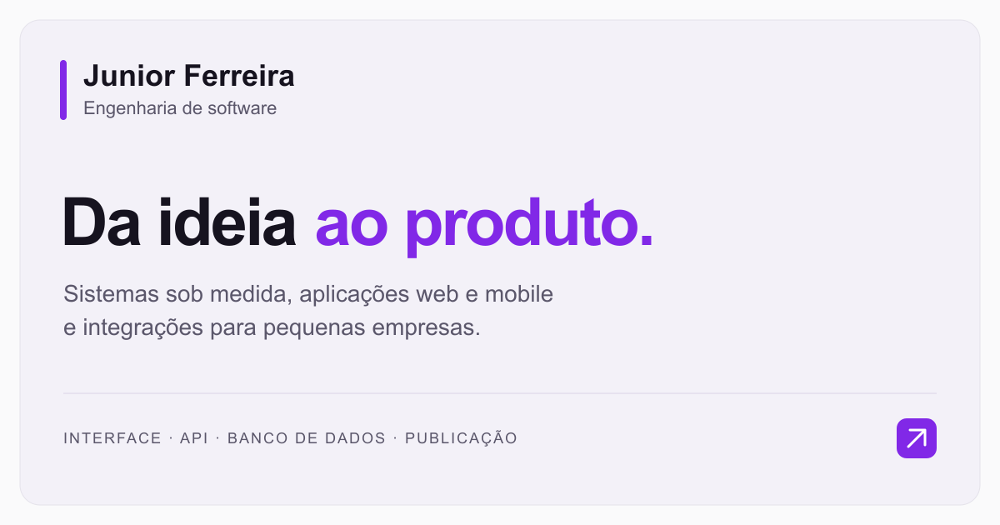

# Junior Ferreira | Engenharia de software

Da ideia ao produto: sistemas sob medida, aplicações web e mobile e integrações para pequenas empresas.

Portfólio profissional com serviços, projetos em produção, processo de trabalho, laboratório, experiência e canais de contato.

[Acessar o portfólio](https://ferreirajr.netlify.app/) · [LinkedIn](https://www.linkedin.com/in/joseilton-junior/) · [GitHub](https://github.com/joseiltonjunior)



## Versão atual

A V2 é a página principal do projeto. A V1 permanece disponível para consulta.

| Endereço       | Versão                                                  |
| -------------- | ------------------------------------------------------- |
| `/`            | V2 — página principal                                   |
| `/?preview=v1` | V1 — versão anterior                                    |
| `/?preview=v2` | V2 — compatibilidade com o endereço de preview anterior |

Essa seleção funciona em desenvolvimento e no build de produção. O site público acompanha o último deploy realizado.

### Experiência da V2

- Layout responsivo, com tema claro.
- Português ou inglês conforme a preferência principal do navegador, sem seletor visual ou parâmetro de idioma na URL. Inglês seleciona `en-US`; os demais idiomas usam `pt-BR` como padrão.
- Navegação por seções, com header que se recolhe ao descer e reaparece ao subir.
- Animações discretas de entrada, respeitando a preferência por movimento reduzido.
- Cases e links de projetos mantidos no código, sem consulta dinâmica ao GitHub.
- Contato por WhatsApp e e-mail.

**Formulário de contato:** a V2 contém os campos nome, e-mail e mensagem, com validação local. O envio está desabilitado e a interface informa essa condição. A integração com Firebase pertence ao formulário da V1; a V2 ainda não envia nem persiste mensagens.

## Tecnologias

| Área                    | Ferramentas                                      |
| ----------------------- | ------------------------------------------------ |
| Interface               | React 18 e TypeScript                            |
| Desenvolvimento e build | Vite                                             |
| Estilos                 | styled-components                                |
| Traduções               | i18next e react-i18next                          |
| Formulário e validação  | React Hook Form e Yup                            |
| Testes                  | Vitest                                           |
| Qualidade de código     | ESLint e Prettier                                |
| Catálogo de componentes | Storybook, com histórias dos componentes legados |
| Integração legada       | Firebase / Firestore na V1                       |

A aplicação renderiza no navegador com React. O build atual não gera o conteúdo das seções por SSR ou pré-renderização.

## Executar localmente

Pré-requisitos: Node.js e Yarn Classic (1.x). Utilize o `yarn.lock` versionado para instalar as dependências.

```sh
git clone https://github.com/joseiltonjunior/portfolio.git
cd portfolio
yarn install --frozen-lockfile
yarn start
```

Abra [localhost:3000](http://localhost:3000/). Para consultar a versão anterior, use [localhost:3000/?preview=v1](http://localhost:3000/?preview=v1).

### Configuração do Firebase — V1

A V2 não depende de credenciais Firebase para exibir a página. Para utilizar a integração da V1, configure um arquivo `.env.local` na raiz com os dados do seu projeto Firebase:

```dotenv
VITE_API_KEY=
VITE_AUTH_DOMAIN=
VITE_PROJECT_ID=
VITE_STORAGE_BUCKET=
VITE_MESSAGING_SENDER_ID=
VITE_APP_ID=
VITE_MEASUREMENT_ID=
```

As variáveis são lidas em `src/services/firebase.ts`. O formulário legado grava documentos na coleção `messages` do Firestore; esse código não implementa envio de e-mail. A gravação depende da configuração e das regras de acesso do projeto Firebase.

Arquivos `.env` e `*.local` são ignorados pelo Git. Variáveis com prefixo `VITE_` são incorporadas ao código do navegador e não devem conter segredos de servidor.

## Comandos

| Comando                | Finalidade                                                 |
| ---------------------- | ---------------------------------------------------------- |
| `yarn start`           | Iniciar o servidor de desenvolvimento                      |
| `yarn build`           | Validar TypeScript e gerar o build em `dist/`              |
| `yarn preview`         | Servir o build localmente, depois de executar `yarn build` |
| `yarn test`            | Executar os testes com Vitest                              |
| `yarn storybook`       | Abrir o Storybook na porta 6006                            |
| `yarn build-storybook` | Gerar o catálogo estático do Storybook                     |

### Lint e tipos

```sh
yarn eslint src .storybook/preview.tsx vite.config.ts vitest.config.ts --ext ".ts,.tsx" --ignore-pattern "!.storybook/" --max-warnings 0 --no-cache
yarn tsc --noEmit --incremental false -p tsconfig.json
```

### Formatação

O projeto usa aspas simples, sem ponto e vírgula, indentação de dois espaços e largura de 80 caracteres, conforme as opções de formatação do ESLint.

```sh
yarn prettier --write src .storybook index.html package.json tsconfig.json tsconfig.node.json vite.config.ts vitest.config.ts README.md .eslintrc.json --single-quote --no-semi --trailing-comma all --arrow-parens always --print-width 80 --end-of-line lf
```

Substitua `--write` por `--check` para conferir a formatação sem alterar arquivos. Esses comandos usam diretamente as ferramentas instaladas; não há scripts `lint` ou `format` no `package.json`.

Os testes cobrem a seleção de idioma, o conteúdo e os links das seções em português e inglês, a validação do formulário e a lógica de visibilidade do header.

## Organização do projeto

```text
public/
  favicon.ico
  social-card.png             # Imagem de compartilhamento (1200 × 630)
  social-card.svg             # Fonte editável da imagem
src/
  App.tsx                    # Seleção entre V2 e V1
  main.tsx                   # Inicialização da aplicação
  data/home.ts               # Projetos, tecnologias, links e contatos da V2
  i18n/
    preview.ts               # Traduções e seleção de idioma da V2
    index.ts                 # Configuração de idioma da V1
    translations/            # Traduções da V1
  screens/Home/
    index.tsx                # Composição da página V2
    styles.ts                # Estilos e tokens visuais da V2
    components/              # Header, Hero, Services, Cases, Process,
                             # Laboratory, Experience, Contact e Footer
    hooks/                   # Animações de entrada
  pages/Home/                # Página V1
  components/                # Componentes legados e histórias do Storybook
  hooks/                     # Providers e hooks compartilhados/legados
  services/                  # Firebase e API do GitHub utilizados pela V1
  styles/                    # Tema e estilos compartilhados/legados
  types/                     # Tipos da aplicação
.storybook/                  # Configuração do Storybook
index.html                   # Documento inicial e metadados
```

O alias `~/` aponta para `src/`. Os nomes `preview.ts` e `Preview*` foram preservados da etapa de desenvolvimento da V2, que agora é a página principal.

## Atualizar conteúdo e compartilhamento

| Alteração                                     | Arquivo ou diretório                                |
| --------------------------------------------- | --------------------------------------------------- |
| Textos em português e inglês                  | `src/i18n/preview.ts`                               |
| Projetos, tecnologias e endereços de contato  | `src/data/home.ts`                                  |
| Seções e componentes da V2                    | `src/screens/Home/components/`                      |
| Cores, tipografia e espaçamentos da V2        | `src/screens/Home/styles.ts` e estilos das seções   |
| Título, descrição, Open Graph e cartão social | `index.html`                                        |
| Imagem do cartão social                       | `public/social-card.svg` e `public/social-card.png` |

Título, descrição e metadados de compartilhamento são fornecidos em português no HTML inicial. O conteúdo da página continua seguindo o idioma do navegador. Essa escolha não garante que o Google indexe exclusivamente a versão em português.

O cartão utiliza URLs absolutas de `https://ferreirajr.netlify.app/`. Ao trocar de domínio, atualize `og:url`, `og:image` e `twitter:image` em `index.html`. Ao editar o SVG, exporte também o PNG em 1200 × 630: as plataformas de compartilhamento utilizam o PNG, e o build não faz essa conversão automaticamente.

## Publicação

Para publicar na Netlify:

- **Comando de build:** `yarn build`
- **Diretório de publicação:** `dist`
- **Variáveis de ambiente:** configurar as variáveis Firebase se a V1 precisar utilizar essa integração.

Executar o build ou o preview local não publica o site. A V2, os metadados e a imagem de compartilhamento chegam ao endereço público no deploy que incluir essas alterações.
